# CrazyGame

**个人持仓观察与 AI 决策辅助工具，支持 PC Web 与 Android 独立运行。**

<p align="center">
  
  
  
  
  
</p>

<p align="center">
  <a href="README.md">简体中文</a> | <a href="docs/README.en.md">English</a>
</p>

<p align="center">
  <a href="https://github.com/panvv-ai/CrazyGame/releases/latest/download/CrazyGame_1.apk">
    
  </a>
  <a href="https://github.com/panvv-ai/CrazyGame/releases">
    
  </a>
</p>

CrazyGame 帮你只关注少数真正认可的股票与基金，看清真实持仓结构和风险，并借助 AI 整理调仓与买入思路。数据、提醒和配置都保存在本地，可在 PC Web 或 Android 手机上独立运行。

应用采用本地单用户架构，没有账号、登录、注册或权限系统。SQLite 保存配置和业务状态，AI Key 与通知凭据加密存储。

> [!IMPORTANT]
> 行情来自公开网页接口，不是交易所正式授权行情。数据可能延迟、限流或改变格式；场外基金盘中值为估算，正式收益以基金净值为准。

## Android 独立版

Android 版无需连接电脑或云端，安装后即可在手机上独立使用。手机与 PC 各自保存本地数据，不会自动同步；需要迁移时，可通过密码加密的数据包手动导入或导出。

<p align="center">
  <a href="https://github.com/panvv-ai/CrazyGame/releases/latest/download/CrazyGame_1.apk"><strong>下载最新版 CrazyGame_1.apk</strong></a>
  ·
  <a href="https://github.com/panvv-ai/CrazyGame/releases">查看全部版本与 SHA-256</a>
</p>

<table>
  <tr>
    <td width="33%">
      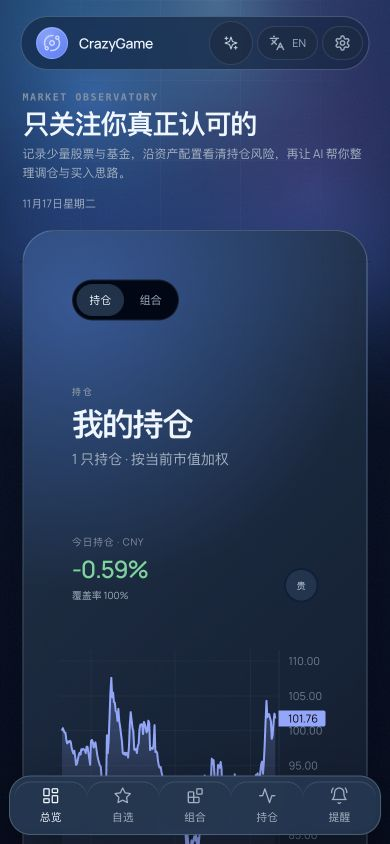
    </td>
    <td width="33%">
      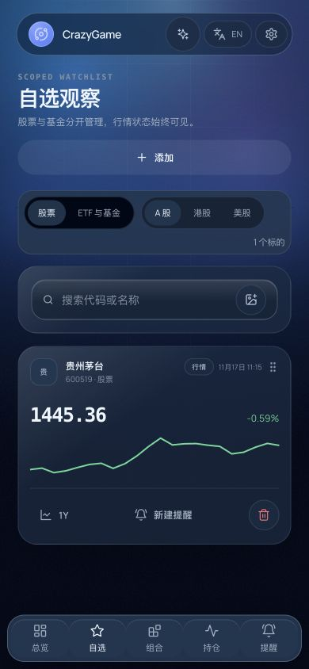
    </td>
    <td width="33%">
      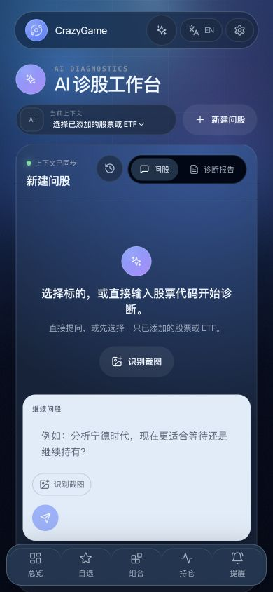
    </td>
  </tr>
  <tr>
    <td align="center">总览与持仓摘要</td>
    <td align="center">触控友好的行情列表</td>
    <td align="center">适配软键盘的 AI 对话</td>
  </tr>
</table>

- **独立运行**：Android 8.0+，无需 Windows、Docker 或局域网连接。
- **当前平台**：仅提供 Android 客户端，暂不支持 iOS。
- **本地优先**：行情状态、自选、组合、持仓、提醒和配置保存在手机本地。
- **原生能力**：支持系统通知、WorkManager 后台检查、触觉反馈和 Android 返回键。
- **完整功能**：保留总览、自选、组合、持仓、提醒、AI 诊股与 AI 问股。
- **跨设备迁移**：PC 与 Android 支持同一套加密 `.crazygame` 数据包导入导出。

## 产品功能

<table>
  <tr>
    <td width="50%">
      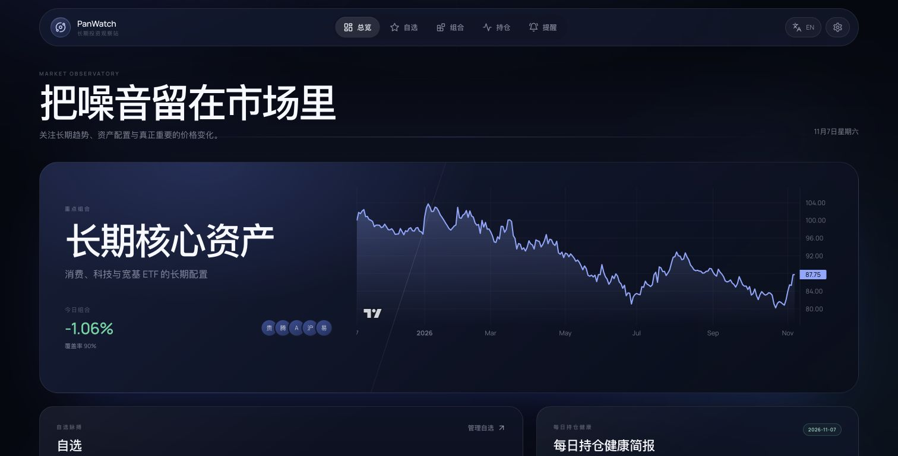
    </td>
    <td width="50%">
      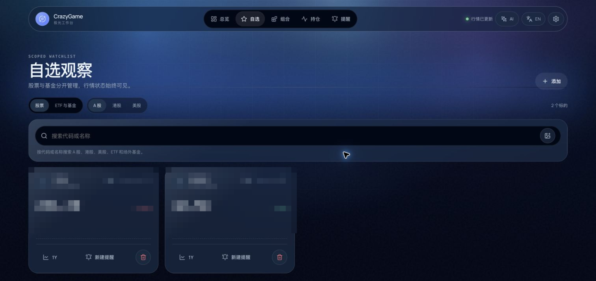
    </td>
  </tr>
  <tr>
    <td align="center">总览持仓与长期曲线</td>
    <td align="center">分区自选与行情状态</td>
  </tr>
  <tr>
    <td width="50%">
      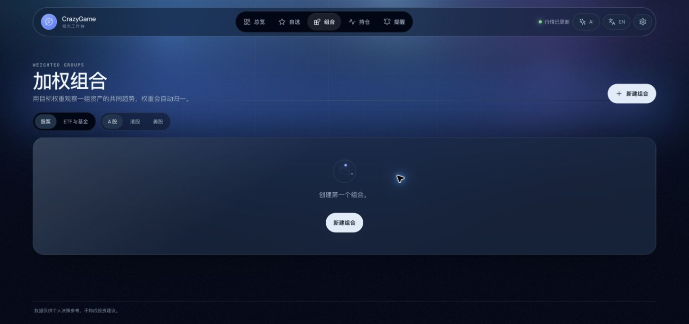
    </td>
    <td width="50%">
      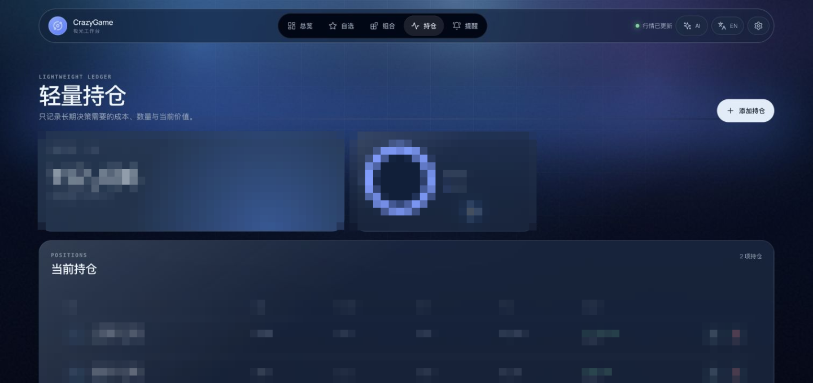
    </td>
  </tr>
  <tr>
    <td align="center">分类加权组合</td>
    <td align="center">轻量持仓与盈亏汇总</td>
  </tr>
  <tr>
    <td width="50%">
      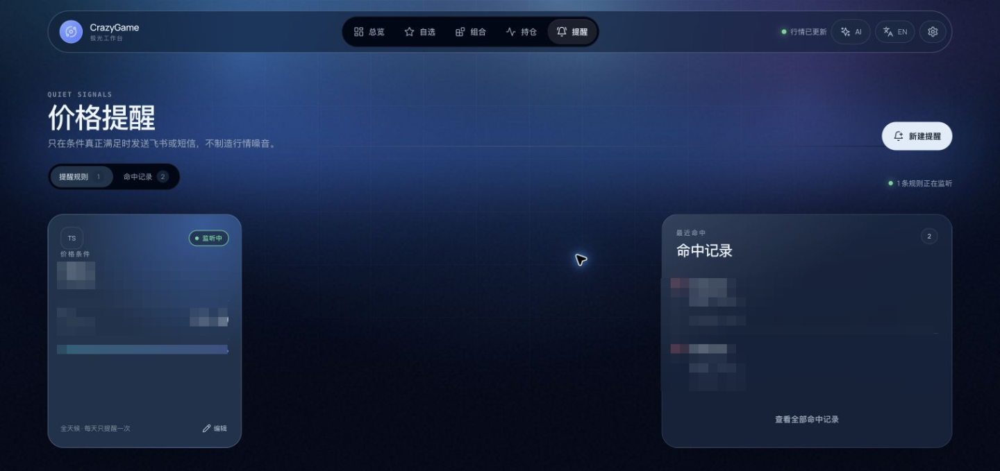
    </td>
    <td width="50%">
      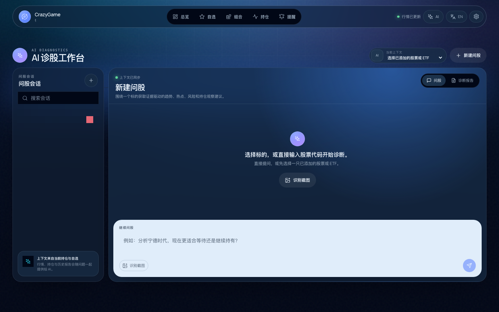
    </td>
  </tr>
  <tr>
    <td align="center">价格提醒与命中记录</td>
    <td align="center">AI 问股与上下文诊断</td>
  </tr>
  <tr>
    <td width="50%">
      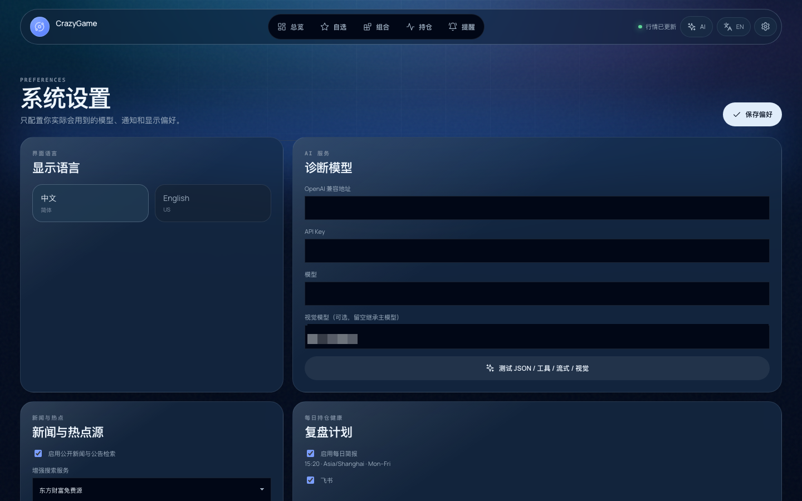
    </td>
    <td width="50%">
      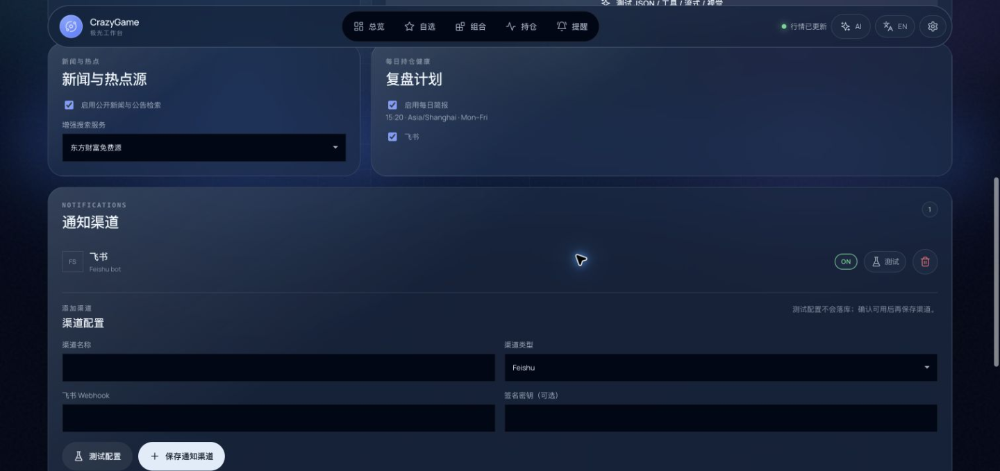
    </td>
  </tr>
  <tr>
    <td align="center">LLM 配置与能力测试</td>
    <td align="center">飞书与短信通知渠道</td>
  </tr>
</table>

> [!IMPORTANT]
> **使用提醒：** 使用 AI 功能前，请先进入“设置”页面完成 LLM Config：填写 Base URL、API Key 和模型，并运行一次能力测试。

| 模块 | 功能 | 说明 |
| --- | --- | --- |
| **AI 诊股** | 结构化决策报告 | 生成趋势、评分、支撑压力、风险、催化剂、仓位建议和操作清单。 |
| **AI 问股** | 工具驱动多轮对话 | 基于行情、技术指标、热点和持仓上下文流式回答，支持会话恢复与追问。 |
| **多模态识别** | 截图找股票 | 从股票截图识别 A 股、港股、美股或场内 ETF，确认后加入自选或开始诊断。 |
| **AI 简报** | 每日持仓健康 | A 股交易日 15:20 自动生成，15:28 失败重试，支持 Markdown 展示。 |
| **行情观察** | 分区自选 | 股票按 A 股、港股、美股分区；基金按场内 ETF、场外基金分区。 |
| **持仓管理** | 轻量持仓与盈亏 | 记录数量、平均成本和备注，按币种汇总市值与浮动盈亏。 |
| **分类组合** | 加权观察篮 | 同分类标的按相对权重归一，展示加权涨跌、覆盖率和长期曲线。 |
| **行情曲线** | 多周期趋势 | 支持 1 月、3 月、1 年、3 年、全部，组合可叠加最多 5 条成分线。 |
| **智能提醒** | 价格与涨跌幅 | 支持每天一次、每 30 分钟、每小时或每 6 小时，可选立即检查一次，并支持交易时段门控、飞书和短信投递。 |
| **通知渠道** | 先测试后保存 | 飞书和阿里云短信可先测试未保存的配置；测试消息不会写入数据库。 |
| **热点证据** | 新闻与公告 | 默认使用东方财富公开数据，按相关性与时效排序，可配置 Tavily/Bocha。 |
| **本地部署** | 一键启动 | Docker Compose 构建运行，默认仅监听 `127.0.0.1`。 |

## 技术栈

| 层级 | 技术 |
| --- | --- |
| 后端 API | Python 3.11、FastAPI、Pydantic、SQLAlchemy |
| 调度与存储 | APScheduler、SQLite、WAL |
| 行情层 | Tencent、Sina、Eastmoney、Stooq |
| 场外基金 | 天天基金估值、东方财富净值 |
| 前端 | React 18、TypeScript、Vite、i18next |
| 图表 | lightweight-charts |
| AI | OpenAI 兼容 Chat Completions、Tool Calls、流式输出、图片输入 |
| 通知 | 飞书自定义机器人、阿里云短信 |
| Android | Kotlin、Android WebView、SQLite、WorkManager、Android Keystore |
| 部署 | Docker Compose |

## 快速开始

### 一键脚本

```bash
git clone https://github.com/panvv-ai/CrazyGame.git
cd CrazyGame
./docker-start.sh v2
```

脚本会自动构建并启动容器，完成后访问 <http://127.0.0.1:8000>。

### Android 安装

1. 从 [GitHub Releases](https://github.com/panvv-ai/CrazyGame/releases) 下载最新 `CrazyGame_1.apk`；发布页同时提供 `.sha256` 校验文件。
2. 在 Android 手机上允许当前文件管理器或浏览器安装未知来源应用，然后打开 APK 完成安装。
3. 首次启动后按需配置 LLM、通知渠道和自选标的。Android 数据与 PC 端独立保存。

> [!NOTE]
> APK 通过 GitHub Releases 分发，不会随源码仓库提交。若某个版本附带了 `.sha256` 文件，可先校验下载文件的完整性再安装。

### Android 开发构建

Android 版与 PC Web 使用同一套 React 源码，但业务数据分别保存在设备本地。

```bash
make android-debug
make android-release
```

Debug APK 位于 `android/app/build/outputs/apk/debug/app-debug.apk`。签名发布版通过
`mobile-v*` 标签由 GitHub Actions 生成。开发环境和签名说明见
[Android Development](docs/mobile-android-development.md)。

## 配置

CrazyGame 不提供环境配置文件。语言、LLM Config、新闻检索和通知渠道均在设置页完成，凭据加密后保存在本地 SQLite。

填写服务商提供的 Base URL、API Key 和模型 ID；视觉模型可留空继承主模型。先运行能力测试，通过后再保存配置。

通知渠道同样支持“先测试、后保存”。提醒频次在表单中统一选择，立即检查为可选项且默认关闭。

## 项目结构

```text
.
├── backend/
│   ├── main.py
│   ├── requirements.txt
│   ├── src/crazygame/
│   │   ├── api/          # FastAPI、依赖和路由
│   │   ├── core/         # 配置、数据库、密钥、日历
│   │   ├── domain/       # ORM、schema 和确定性业务规则
│   │   ├── providers/    # 场外基金数据适配
│   │   └── services/     # 行情、提醒、通知、AI、调度
├── frontend/
│   ├── src/crazygame/     # React 页面、组件、i18n 和设计系统
│   └── public/
├── android/               # Kotlin WebView、本地存储、通知与后台任务
├── marketdata/           # 可复用股票/ETF 行情包
├── docs/                 # 架构、设计和英文 README
├── docker-start.sh       # 一键构建与部署
├── compose.yaml
├── Dockerfile
└── Makefile
```

更详细的数据流和模块职责见 [架构文档](docs/architecture.md)，视觉规则见 [设计语言](docs/design-language.md)。

## 数据与隐私

CrazyGame 是一个纯本地、纯个人、极轻量的项目：没有云端服务器，也不存在远端数据存储。SQLite 数据库、配置和加密密钥均保存在本机；使用 AI 或新闻功能时，请求会按你的配置发送至相应第三方服务。

## 免责声明

本项目仅供学习和研究使用，不构成任何投资建议。股市有风险，投资需谨慎。作者不对使用本项目产生的任何损失负责。

## 开源协议

Copyright © 2026 CrazyGame contributors.

本项目采用 [MIT License](LICENSE)。

参考项目的架构与交互设计归属见 [第三方声明](docs/third-party-notices.md)。
