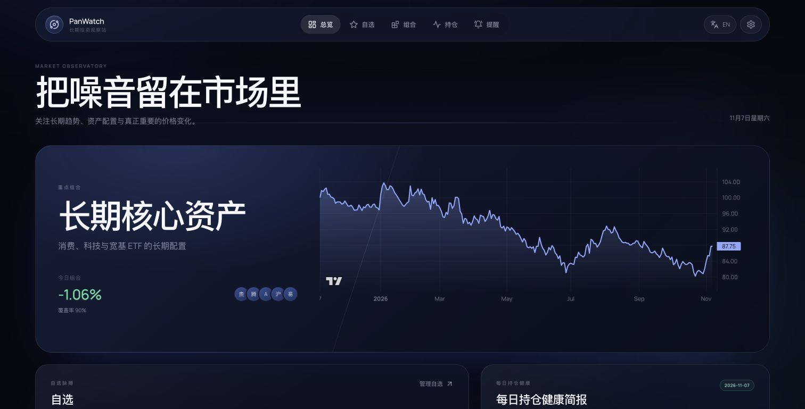

# CrazyGame

**个人持仓观察与 AI 决策辅助工具。**

<p align="center">
  
  
  
  
</p>

<p align="center">
  <a href="README.md">简体中文</a> | <a href="docs/README.en.md">English</a>
</p>

CrazyGame 帮你只关注少数真正认可的股票与基金，看清真实持仓结构和风险，并借助 AI 整理调仓与买入思路。数据、提醒和配置都保存在本地。

应用采用本地单用户架构，没有账号、登录、注册或权限系统。SQLite 保存配置和业务状态，AI Key 与通知凭据加密存储。

> [!IMPORTANT]
> 行情来自公开网页接口，不是交易所正式授权行情。数据可能延迟、限流或改变格式。场外基金盘中值为估算，正式收益以基金净值为准。本项目仅供个人研究，不构成投资建议。

## 产品功能

<p align="center">
  
</p>

- **分区自选**：股票按 A 股、港股、美股分开查看；基金按场内 ETF、场外基金分开查看。
- **持仓优先总览**：首页默认展示真实持仓的市值加权表现和曲线，可切换到组合观察。
- **场外基金**：支持基金搜索、盘中估值、正式净值与历史净值曲线。
- **分类组合**：用目标权重组织同一分类的观察篮，权重自动归一，并展示当日加权涨跌、覆盖率和归一曲线。
- **长期曲线**：支持 1 月、3 月、1 年、3 年、全部，组合可叠加最多 5 条成分线。
- **轻量持仓**：单账户记录数量、平均成本、市值和浮动盈亏，并按币种汇总。
- **智能提醒**：价格或当日涨跌幅阈值，支持每日一次、冷却时间和交易时段门控。
- **飞书与短信**：每个提醒可独立选择通知渠道，支持重试和投递状态追踪。
- **每日持仓健康**：A 股交易日 15:20 自动生成，15:28 失败重试；简报按 Markdown 渲染。
- **AI 诊股工作台**：按需生成趋势、评分、支撑压力、风险、催化、空仓/持仓建议和操作检查清单。
- **多轮问股**：围绕一个主标的进行工具驱动分析，支持流式结论、会话恢复和后续追问。
- **截图识别**：从自选股截图中识别股票或 ETF，经用户确认后加入自选或开始诊股。
- **高相关热点**：默认使用东方财富公开新闻、公告、行业和概念数据，按相关性与时效排序；可选手动配置 Tavily/Bocha 增强。
- **双语界面**：默认中文，可随时切换英文；AI 简报和提醒跟随界面语言。
- **本地部署**：Docker Compose 一条命令启动，默认仅监听 `127.0.0.1`。

## 技术栈

| 层级 | 技术 |
| --- | --- |
| 后端 API | Python 3.11、FastAPI、Pydantic、SQLAlchemy |
| 调度与存储 | APScheduler、SQLite、WAL |
| 行情层 | Tencent、Sina、Eastmoney、Stooq |
| 场外基金 | 天天基金估值、东方财富净值 |
| 前端 | React 18、TypeScript、Vite、i18next |
| 图表 | lightweight-charts |
| 通知 | 飞书自定义机器人、阿里云短信 |
| 部署 | Docker Compose |

## 快速开始

### 环境要求

- Python 3.11
- Node.js 22+
- pnpm 10+
- Docker Desktop（可选）

### 方式一：一键脚本（推荐）

```bash
git clone https://github.com/panvv-ai/CrazyGame.git
cd CrazyGame

./docker-start.sh v2
```

脚本会：

- 拉取缺失的 Node/Python 基础镜像，并自动重试
- 构建 `crazygame:v2`
- 用 `v2` 强制重建容器
- 等待健康检查后输出访问地址

打开 <http://127.0.0.1:8000>。

其他用法：

```bash
./docker-start.sh v3               # 构建并部署新版本
./docker-start.sh --no-build v2    # 部署已经构建好的镜像
./docker-start.sh --no-cache v2    # 完全无缓存构建
./docker-start.sh --dry-run v2     # 只打印步骤，不执行
```

如果 Docker Hub 元数据下载报 `EOF` 或超时，先配置 Docker Desktop 的 Proxy；临时也可使用可达镜像源：

```bash
CRAZYGAME_NODE_IMAGE=docker.m.daocloud.io/library/node:22-alpine \
CRAZYGAME_PYTHON_IMAGE=docker.m.daocloud.io/library/python:3.11-slim \
  ./docker-start.sh v2
```

传统 Compose 方式仍然可用：

```bash
docker compose up -d --build
# 或部署已有镜像
CRAZYGAME_TAG=v2 docker compose up -d --no-build --force-recreate
```

查看日志：

```bash
docker compose logs -f crazygame
```

停止服务：

```bash
docker compose down
```

容器只映射到本机回环地址，SQLite 与凭据密钥保存在 `crazygame_data` volume。

### 方式二：本地开发

```bash
git clone https://github.com/panvv-ai/CrazyGame.git
cd CrazyGame

make setup
make dev-api
```

另开一个终端：

```bash
make dev-web
```

打开 <http://127.0.0.1:5183>。Vite 会把 `/api` 代理到本地 FastAPI。

生产式本地运行：

```bash
cd frontend && pnpm build
cd ..
mkdir -p backend/static
cp -R frontend/dist/. backend/static/
cd backend && ../.venv/bin/python main.py
```

打开 <http://127.0.0.1:8000>。

### 手动构建 Docker 镜像

```bash
docker build --build-arg CRAZYGAME_TAG=v2 -t crazygame:v2 .
CRAZYGAME_TAG=v2 docker compose up -d --no-build --force-recreate
```

如果不使用 Compose，也可以直接运行：

```bash
docker run -d \
  --name crazygame \
  --restart unless-stopped \
  -p 127.0.0.1:8000:8000 \
  -v crazygame_data:/app/data \
  crazygame:v2
```

打开 <http://127.0.0.1:8000>。

## 使用方式

### 添加自选

在“自选”页先选择“股票”或“基金”，再切换 A 股、港股、美股、场内 ETF、场外基金分类。搜索代码或名称后添加；港股代码会自动补足 5 位，场外基金代码补足 6 位。拖动卡片抓手可以调整当前分类内的显示顺序。

### 添加分类组合

在“组合”页选择与组合相同的分类后，从该分类的自选标的中填写相对权重。例如 `30 / 25 / 20 / 15 / 10` 会被归一为 `30% / 25% / 20% / 15% / 10%`。不同市场或不同基金类型不能混在同一个组合中。

### 记录持仓

在“持仓”页选择已有自选标的，填写数量和平均成本。多币种分别汇总，不进行隐含汇率换算。

### 组合与持仓怎么区分

“持仓”记录你实际持有的数量、平均成本和浮盈亏，是每日健康简报的唯一分析来源。

“组合”不记录真实仓位，只用于把几只关注标的按目标权重组成一个观察篮，查看假设配置下的共同涨跌和长期曲线。如果只需要分析真实资产，可以不使用组合功能。

### 设置提醒

在提醒表单中选择价格或涨跌幅条件、方向和阈值。飞书和阿里云短信需要在设置页先完成配置。

阿里云提醒模板变量为：

```text
${rule} ${name} ${price} ${change}
```

### 查看每日健康简报

服务在 A 股交易日 15:20 生成持仓健康简报。需要先在设置页配置 OpenAI 兼容的 AI 服务和模型。

### 使用 AI 诊股与问股

点击顶栏“AI”进入 AI 工作台。可以：

- 从已添加的股票或 ETF 中选择标的，生成结构化 AI 决策报告。
- 直接在问股窗口输入代码、名称或问题；明确给出新标的时会切换当前讨论对象。
- 在行情详情中点击“AI 诊断”或“继续问股”跳转到当前标的。
- 上传自选股截图，经视觉模型识别后选择标的；识别结果不会自动写入数据库。

AI 诊股首版覆盖 A 股、港股、美股和 A 股场内 ETF。场外基金继续使用现有估值、净值和每日组合简报。

## 配置

CrazyGame 不提供环境配置文件。首次启动会在 `DATA_DIR` 中自动生成加密密钥，AI 模型、视觉模型、新闻增强和通知渠道全部在页面设置中配置，凭据加密后保存在 SQLite。

`docker-start.sh` 通过参数接收镜像 tag。基础镜像网络受限时，可以在命令前临时传入 `CRAZYGAME_NODE_IMAGE` / `CRAZYGAME_PYTHON_IMAGE` 覆盖镜像源，无需保存配置文件。

## 项目结构

```text
.
├── backend/
│   ├── main.py
│   ├── requirements.txt
│   ├── src/crazygame/
│   │   ├── api/          # FastAPI、依赖和路由
│   │   ├── core/         # 配置、数据库、密钥、日历
│   │   ├── domain/       # ORM、schema 和确定性业务规则
│   │   ├── providers/    # 场外基金数据适配
│   │   └── services/     # 行情、提醒、通知、AI、调度
├── frontend/
│   ├── src/crazygame/     # React 页面、组件、i18n 和设计系统
│   └── public/
├── marketdata/           # 可复用股票/ETF 行情包
├── docs/                 # 架构、设计和英文 README
├── docker-start.sh       # 一键构建与部署
├── compose.yaml
├── Dockerfile
└── Makefile
```

更详细的数据流和模块职责见 [架构文档](docs/architecture.md)，视觉规则见 [设计语言](docs/design-language.md)。

## 数据与隐私

- 默认数据库：`DATA_DIR/crazygame.sqlite3`。
- 默认本地密钥：`DATA_DIR/.app-secret`，权限为 `0600`。
- AI Key、飞书签名和阿里云 AccessKey 加密后写入 SQLite。
- API 不会返回完整凭据，只返回掩码。
- AI 诊股会把当前标的的行情、技术指标、相关新闻以及当前持仓成本发送到你配置的 AI 服务，用于生成空仓/持仓建议；不配置 AI 时不会发生此请求。
- 新闻与公告检索会访问东方财富公开接口；关闭 `NEWS_ENABLED` 或设置页新闻开关后停止该请求。
- 图片识别只在内存中处理上传图片，并将图片发送至配置的视觉模型，不保存原图。
- 只有在用户确认后，截图识别出的标的才会加入自选或用于聊天。
- 不要把无认证服务直接暴露到公网。Compose 默认只发布到 `127.0.0.1`。

## 开发与构建

```bash
make setup
cd frontend
pnpm check:i18n
pnpm build
```

## 已知限制

- 只支持 A 股场内 ETF，不包含港股和美股 ETF。
- 场外基金无法提供连续交易价格，估值与正式净值必须区分。
- 公开行情源没有 SLA，可能临时不可用。
- 公开新闻和热点源没有 SLA；不可用时报告会标注数据限制，不会编造热点。
- AI 诊股和问股按需触发，不会自动分析整个自选列表。
- 首版不支持场外基金 AI 诊股或股票横向比较。
- 目前只有深色主题。
- AI 输出只作为个人研究辅助，不会自动交易。

## 开源协议

Copyright © 2026 CrazyGame contributors.

本项目采用 [MIT License](LICENSE)。

参考项目的架构与交互设计归属见 [第三方声明](docs/third-party-notices.md)。
