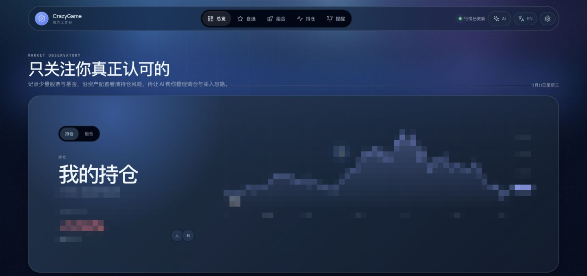
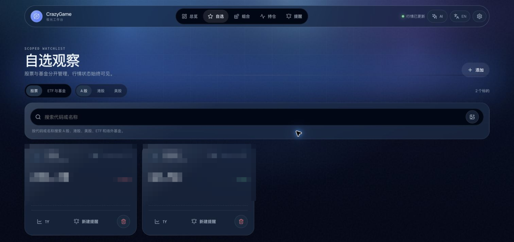
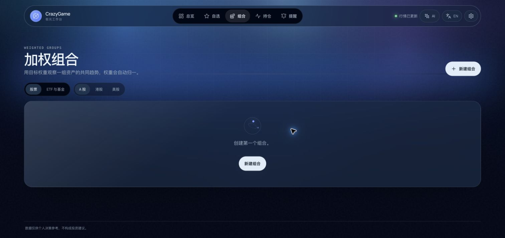
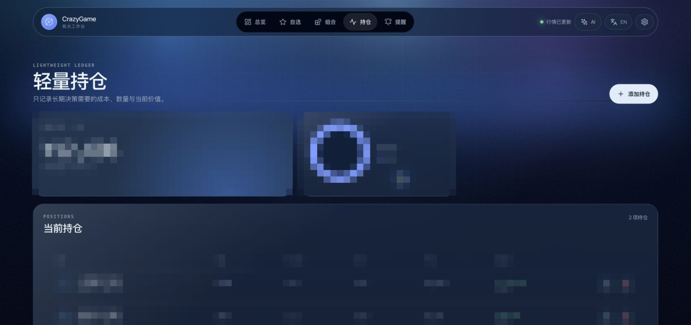
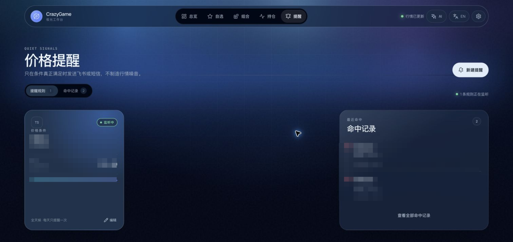
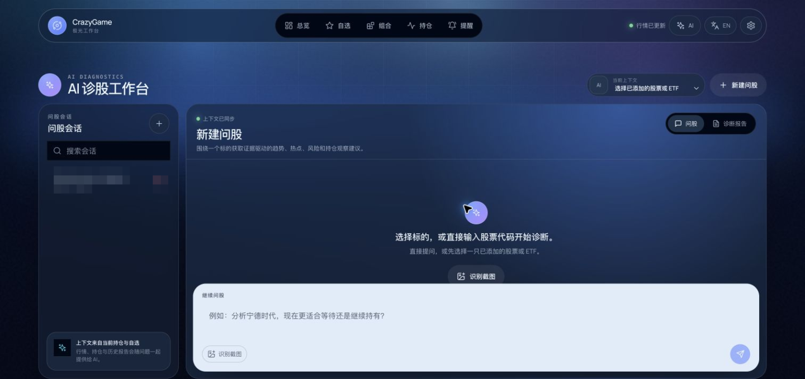
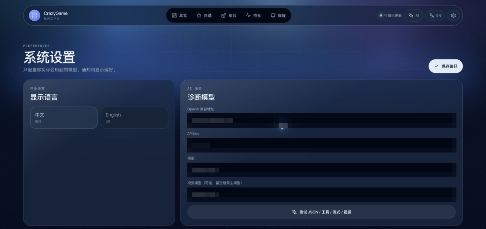
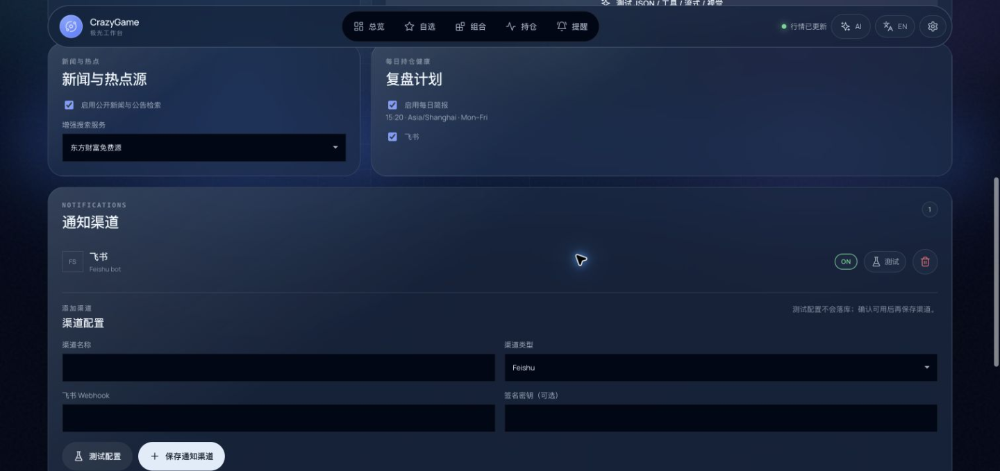

# CrazyGame

**A local-first portfolio observatory with AI decision support.**

<p align="center">
  
  
  
  
</p>

<p align="center">
  <a href="../README.md">简体中文</a> | <a href="README.en.md">English</a>
</p>

CrazyGame helps you follow a small set of stocks and funds you genuinely care about, understand allocation and risk, and use AI to organize possible next steps. Data, alerts, and configuration stay local.

The interface uses layered light fields and compact control rails: the ambient background shifts subtly with scrolling, while primary actions stay available in the first viewport. AI diagnosis uses a single-screen layout with its composer always in view.

CrazyGame is a local, single-user application with no account, login, registration, or permission system. SQLite stores application state, while AI and notification credentials are encrypted at rest.

> [!IMPORTANT]
> Quotes come from public web endpoints, not licensed exchange feeds. Data may be delayed, rate-limited, or changed; intraday open-end fund values are estimates, and official NAV governs returns.

## Features

<table>
  <tr>
    <td width="50%">
      
    </td>
    <td width="50%">
      
    </td>
  </tr>
  <tr>
    <td align="center">Portfolio overview and long-term curve</td>
    <td align="center">Scoped watchlist and market status</td>
  </tr>
  <tr>
    <td width="50%">
      
    </td>
    <td width="50%">
      
    </td>
  </tr>
  <tr>
    <td align="center">Category-scoped weighted groups</td>
    <td align="center">Lightweight holdings and P/L summary</td>
  </tr>
  <tr>
    <td width="50%">
      
    </td>
    <td width="50%">
      
    </td>
  </tr>
  <tr>
    <td align="center">Price alerts and hit history</td>
    <td align="center">AI chat with portfolio context</td>
  </tr>
  <tr>
    <td width="50%">
      
    </td>
    <td width="50%">
      
    </td>
  </tr>
  <tr>
    <td align="center">LLM configuration and capability checks</td>
    <td align="center">Feishu and SMS notification channels</td>
  </tr>
</table>

> [!IMPORTANT]
> **Before using AI:** open **Settings**, complete LLM Config with the Base URL, API Key, and model, then run a capability test.

| Module | Feature | Description |
| --- | --- | --- |
| **AI diagnosis** | Structured decision reports | Generates trend, score, support and resistance, risks, catalysts, position guidance, and an action checklist. |
| **AI chat** | Tool-driven multi-turn analysis | Streams answers grounded in quotes, technical indicators, news, and portfolio context, with session recovery and follow-up questions. |
| **Multimodal input** | Screenshot recognition | Recognizes stocks and listed ETFs from screenshots, then continues to watchlist or diagnosis after user confirmation. |
| **AI review** | Daily portfolio health | Runs after the A-share close at 15:20, retries at 15:28, and renders the result as Markdown. |
| **Market observatory** | Scoped watchlists | Separates stocks into A-share, Hong Kong, and US views; separates funds into listed ETF and open-end fund views. |
| **Holdings** | Lightweight P/L tracking | Records quantity, average cost, and notes, with market value and unrealized P/L grouped by currency. |
| **Weighted groups** | Category-scoped baskets | Normalizes relative weights within one category and shows weighted performance, coverage, and long-term curves. |
| **Market curves** | Multiple time ranges | Supports 1 month, 3 months, 1 year, 3 years, and all history, with up to five member lines per group. |
| **Alerts** | Price and daily-change thresholds | Supports daily, 30-minute, hourly, or 6-hour frequency, optional immediate checking, market-hours gating, and Feishu or SMS delivery. |
| **Notification channels** | Test before saving | Tests unsaved Feishu and Alibaba Cloud SMS credentials without persisting the draft. |
| **Evidence** | Ranked news and announcements | Uses public Eastmoney sources by default, ranks evidence by relevance and recency, and optionally supports Tavily or Bocha. |
| **Local deployment** | One-command startup | Builds and runs through Docker Compose and listens only on `127.0.0.1` by default. |

## Stack

| Layer | Technology |
| --- | --- |
| Backend API | Python 3.11, FastAPI, Pydantic, SQLAlchemy |
| Scheduling and storage | APScheduler, SQLite, WAL |
| Market data | Tencent, Sina, Eastmoney, Stooq |
| Open-end funds | Eastmoney fund estimates and NAV |
| Frontend | React 18, TypeScript, Vite, i18next |
| Charts | lightweight-charts |
| AI | OpenAI-compatible Chat Completions, Tool Calls, streaming, and image input |
| Notifications | Feishu bot and Alibaba Cloud SMS |
| Deployment | Docker Compose |

## Quick start

### One-command script

```bash
git clone https://github.com/panvv-ai/CrazyGame.git
cd CrazyGame
./docker-start.sh v2
```

The script builds and starts the container. Open <http://127.0.0.1:8000> when it completes.

## Configuration

CrazyGame does not require an environment configuration file. Language, LLM Config, news search, and notification channels are configured in Settings, with credentials encrypted in local SQLite.

Enter the provider Base URL, API Key, and model ID. Leave the vision model empty to inherit the main model. Run the capability test before saving the configuration.

Notification channels also support "test before saving." Alert frequency is selected as one field, while the optional immediate check remains off by default.

## Project layout

```text
.
├── backend/
│   ├── main.py
│   ├── requirements.txt
│   └── src/crazygame/   # API, domain, core, providers, and services
├── frontend/
│   ├── src/crazygame/   # React UI, components, i18n, and visual system
│   └── public/
├── marketdata/          # Reusable quote and daily-line package
├── docs/                # Architecture, design language, and READMEs
├── docker-start.sh      # One-command build and deployment
├── compose.yaml
├── Dockerfile
└── Makefile
```

See [architecture.md](architecture.md) and [design-language.md](design-language.md) for details.

## Data and privacy

CrazyGame is a local, personal, and lightweight project with no cloud server and no remote data storage. The SQLite database, configuration, and encryption key remain on the local machine. When AI or news features are enabled, requests are sent to the third-party services you configure.

## Disclaimer

This project is for learning and research only and does not constitute investment advice. Markets carry risk, and investment decisions require caution. The author is not responsible for any loss arising from use of this project.

## License

Copyright © 2026 CrazyGame contributors.

Licensed under the [MIT License](../LICENSE).

See [third-party notices](third-party-notices.md) for architecture and interaction references.
